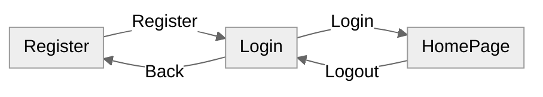
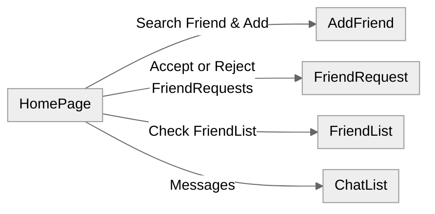
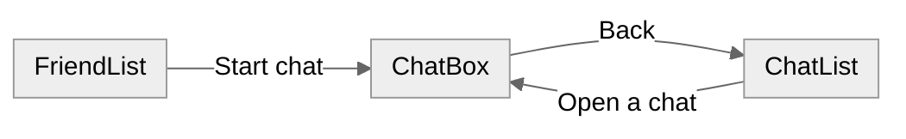

# Briefing —— Replica of QQ
## Key word of the app

- **Register**
- **Log in**
- **Add Friend**
- **Real-time Chatting**
- **Client-Server Framework**
## CLIENT: Planned features & Screens

- Register and log in (Register, Login)
- Create a HomePage to manage screen-switching rules (HomePage)
- Search by username and send a friend request (AddFriend)
- Accept or reject a friend request (FriendRequest)
- View the friend list (FriendList)
- Open a chat from a friend (FriendList->ChatBox)
- View the chat list (ChatList)
- Send and receive messages in real time (ChatBox&ChatList)

## Screen-switching Rules

Register, login, and logout.

Where HomePage can go. AddFriend, FriendRequest, FriendList, and ChatList each go back to HomePage with Back Home.

How a chat opens. ChatBox goes back to ChatList, not to HomePage.

## SERVER: What does the backend do?

While our mobile phones are running our final app,
there must be a computer running the backend at the same time

**BACKEND IS:** 
the computer program to manage **HTTP** requests sent from the clients
update changes into project database
Also it build and maintain a **SOCKET** channel to make the chats of clients convenient

